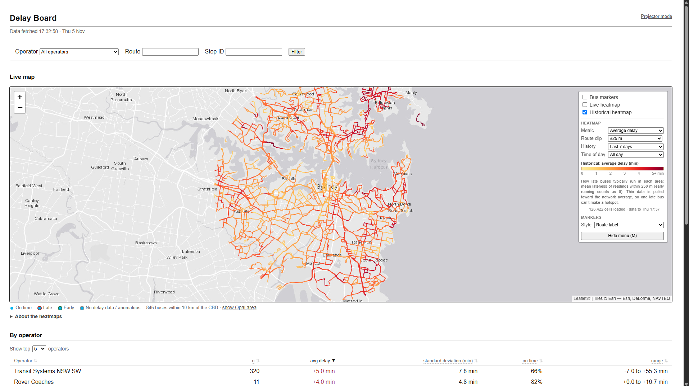

# TfNSW Delay Board

A Flask dashboard that turns live TfNSW bus data into delay statistics, a live vehicle map and live and historical heatmaps of delay, on-time running, speed and bus density. A projector mode locks the map to the TransportLab physical model of Sydney so the heatmaps can be projected onto it.

Built for CIVL3704 Transport Informatics (University of Sydney) by Group 1. The deployed dashboard is at [civl3704.joeyhain.org](https://civl3704.joeyhain.org) and projector mode at [/project](https://civl3704.joeyhain.org/project).

## Setup

Install the dependencies (Python 3.11):

```bash
pip install -r requirements.txt
```

Create a `.env` file in the project directory:

```env
TFNSW_API_KEY=your_api_key_here
```

A TfNSW Open Data API key with access to the bus realtime trip update, vehicle position and timetable feeds is required. Never hardcode the key into a script; read it with `os.getenv("TFNSW_API_KEY")`.

## Run

```bash
python app.py
```

Open [http://localhost:5000](http://localhost:5000) in a browser. The first page load after starting takes about 30 seconds while the bus timetable is downloaded; after that pages load immediately.



## Features

- Live bus delay information, with on time defined by the TfNSW on-time running KPI (no more than 59 seconds early or 5 minutes 59 seconds late)
- Operator and route summaries
- Interactive vehicle map with delay-status marker colours
- Click a bus to see its route and upcoming stops, coloured by predicted delay
- Live and historical heatmaps: average delay, delay burden, not on time, speed and bus density
- Historical windows from the last hour to 7 days, custom date ranges of up to 7 days and time-of-day filters
- Heatmaps clipped to the bus road network so delay reads along corridors
- Projector mode with corner calibration for the TransportLab model
- Operator dropdown (operators sharing a name are grouped) plus route and stop ID filters

The dashboard automatically refreshes vehicle positions every 15 seconds and the historical heatmap every 5 minutes.

### External buttons

The Pico firmware emulates a USB keyboard. Connect the Pico by USB to the computer displaying the dashboard, then copy [`main.py`](main.py) to the Pico.

The firmware uses internal pull-downs, so connect each normally-open momentary button between its GPIO pin and the Pico's 3V3 pin (not GND). The firmware sends the key on the falling edge, so with this wiring the action occurs when the button is released. If the USB keyboard is already open when the Pico starts, the firmware may also send each key once during startup. If no external buttons are available, press A, B or C on the dashboard computer's keyboard for the same actions.

| Button | Action |
|---|---|
| GPIO 15 (A) | Cycle live heatmap → historical heatmap → no heatmap |
| GPIO 14 (B) | Cycle through average delay, delay burden, not on time, speed and bus density |
| GPIO 13 (C) | Show or hide bus markers |

## Visualisations

- **Live map:** Each marker represents a currently reporting bus. The label shows its route, and the arrow shows its direction of travel. Marker outlines indicate the bus status: white for on time (0:59 early to 5:59 late, matching the TfNSW on-time KPI), red for late, green for early, and grey when delay data is unavailable or anomalous.
- **Heatmap metrics:** The map menu offers five ways to view the live or historical data. The live layer colours each bus by its current value; the historical layer aggregates recorded vehicle readings over the selected time window and time of day. For the averaged metrics below, sparse readings are blended toward the network-wide average, and opacity indicates how much data supports the local estimate.
  - *Average delay* is the mean positive delay within 250 m; early readings count as zero rather than offsetting late buses. Its colour scale runs from 0 to 5 minutes, with higher values capped at the top of the scale.
  - *Not on time* is the share of readings within 250 m that fall outside the TfNSW window (more than 59 seconds early or more than 5 minutes 59 seconds late). It therefore includes both early and late buses. Its scale runs from 0 to 60%.
  - *Speed* is the mean reported bus speed within 160 m, including readings while buses are stopped. Its scale runs from 0 to 80 km/h; colour represents speed, not road type (the historical ramp runs from amber at lower speeds to purple at higher speeds; the live ramp is green-to-blue).
  - *Delay burden* adds positive delay across historical bus readings in each area. It is scaled so its total map weight matches Bus density: busy corridors may be bright, while an area brighter than its density suggests is contributing a larger share of late readings. On the live layer it highlights buses currently running late.
  - *Bus density* counts recorded vehicle-position readings in each area. It shows where buses are most frequently observed, not the number of unique buses, passengers, or service quality; historical colours are relative within the selected time window.
  "About the heatmaps" under the map provides the same metric guide.
- **Historical heatmap:** Historical data can be viewed over the last hour, 24 hours or 7 days (the default), or a custom date range of up to 7 days within roughly the last two months, and filtered to a time of day (AM peak 06:00–10:00, midday 10:00–15:00, PM peak 15:00–19:00, evening 19:00–06:00). The map aggregates vehicle readings into geographic cells, so each coloured area represents activity within a small location rather than a single bus.
- **Projector mode:** `/project` locks the map to the TransportLab model's extent and blacks out everything outside it. "Hide menu" (or the M key, or `?menu=0`) removes the menu so only the map is projected.
- **Selected bus:** Clicking a bus draws its route (dashed behind the bus, solid ahead) and the stops it still has to serve. The popup names the next stop and the last predicted stop, and says how much time the bus is expected to lose or recover by then. Hoverover  a stop for its name and predicted delay. The route and stops refresh with each 15-second update and clear when the popup closes. Each stop is coloured by the delay TfNSW currently predicts the bus will have there, using the same on-time window:
  - blue on time
  - red late
  - green early
  - grey no prediction.

- **Operator and route tables:** These show the number of distinct bus readings, average delay, standard deviation of delay, percentage running on time, and the observed delay range. Routes can be sorted by delay, spread, or on-time percentage.
- **Individual trips table:** This lists the trips with the largest current delays and identifies their route, operator, most recent stop, and delay status.

## Projector calibration

By default `/project` places the model using the projector settings in its [`params.json5`](https://github.com/TransportLab/smart-city/blob/main/params.json5). Manual Calibration may be required to align the projection and physical model. 

1. Open `/project` on the computer connected to the projector, full screen (F11) at the projector's native resolution.
2. Press K (or "Calibrate projection" in the menu). A crosshair appears on each corner of the model's area.
3. Drag each crosshair onto the matching corner of the physical model. Tab selects the next crosshair and the arrow keys nudge it by 1 px (Shift for 10 px). Align to street-level corners rather than building tops, as the buildings stand above the table.
4. Press K again to finish. The map is warped so the model's corners land on the crosshairs, and nothing is projected outside them.

The calibration is saved in that browser. The calibration box also shows a link containing it; bookmark that link on the projector computer so the calibration can be restored anywhere. R resets it to the default.

## Data

- **Live data:** TfNSW GTFS-Realtime bus trip updates (delays) and vehicle positions, joined on trip ID. The static GTFS timetable supplies operator names and trip destinations.
- **Historical data:** The separate [gtfs-r-scrape](https://github.com/Joey-Hain/gtfs-r-scrape) repository collects vehicle positions and delays. The dashboard normally reads pre-aggregated heatmap cells from that repository's `cells` branch: preset windows use a single published file, and custom date ranges combine daily cell files. If those files are unavailable, it falls back to the raw daily CSVs (`data/` from a GitHub Action and `data-local/` from a home machine running `local_collector.py`), which it parses and caches locally.
- **Route shapes:** gtfs-r-scrape also builds `shapes/route_shapes.json`, a de-duplicated bus road network within 12 km of the CBD, used for route clipping.
- **Selected-bus route and stops:** upcoming stops and their predicted delays come from the live trip update feed. The same gtfs-r-scrape job writes a per-trip lookup (trip to route shape, each route's shape, and stop names and locations) split into small files, so the dashboard downloads only the piece a click needs.

## API

All endpoints return JSON unless noted.

| Endpoint | Description |
|---|---|
| `/` | Dashboard page. Query parameters `operator`, `route`, `stop`, `bounds=0` (whole Opal area) and `sort`. |
| `/project` | Projector mode. `menu=0` hides the menu; `cal=...` restores a calibration. |
| `/api/vehicles` | Live vehicle positions with delay and status. Accepts the same filters as `/`. |
| `/api/heatmap` | Historical heatmap points. `window=1`, `24` or `168` (hours), or `window=custom&start=YYYY-MM-DD&end=YYYY-MM-DD`; `metric=delay` (or `delay_mean`), `delay_total`, `frequency` (not-on-time share), `speed` or `density`; `period=all`, `am_peak`, `midday`, `pm_peak` or `evening`. |
| `/api/validation` | On-time, early and late percentages and mean lateness by operator from the historical data. This is based on bus snapshots rather than TfNSW's trip-level KPI methodology, so use it to compare operator patterns, not as an exact published KPI; accepts the same `window` parameters and `format=csv` for a spreadsheet. |
| `/api/route_shapes` | The bus road network used for route clipping. |
| `/api/trip/<trip_id>` | One live trip: its route shape (`shape`, encoded like `/api/route_shapes`, or null with `shape_error` explaining why), headsign, operator, and upcoming `stops` in order, each with `stop_id`, `name`, `lat`, `lon`, `seq` and predicted `delay_sec`. |
| `/status` | Cache and timetable diagnostics. |
| `/health` | Basic health check; returns `ok`. |
| `/ping` | Health check; returns `pong`. |

## Deployment

The live site runs on Render.com from this repository's `main` branch, redeploying automatically on every push. `render.yaml` holds the settings (start command `gunicorn app:app --bind 0.0.0.0:$PORT --workers 1 --threads 6 --worker-class gthread --timeout 120`, health check `/ping`), and `TFNSW_API_KEY` and `TFNSW_GTFS_RT_URL` are set as environment variables on Render. Historical heatmaps normally use cells pre-aggregated by the gtfs-r-scrape Action (its `cells` branch); raw CSVs are only parsed if those cell files are unavailable. The scraper Action also requests `/ping` after every 5-minute snapshot, which keeps the free instance from going to sleep. Optionally set `GITHUB_TOKEN` so historical-data downloads are authenticated and less likely to hit GitHub's shared-IP rate limit. Don't change `Procfile`, `requirements.txt` or `render.yaml` without checking they still deploy. The free instance has 512 MB of memory and sleeps after 15 minutes without a request; `local_collector.py` in gtfs-r-scrape pings the site every 10 minutes to keep it awake.

To run your own copy, create a Render web service from a fork of this repository (it picks up `render.yaml`) and add your API key as `TFNSW_API_KEY`.

## Documentation

- [docs/ARCHITECTURE.md](docs/ARCHITECTURE.md): how the data pipeline, heatmap aggregation and front end fit together

Build the MkDocs documentation (including the Python API and Pico firmware):

```bash
python -m pip install -r docs/requirements.txt
python -m mkdocs build
```
Microsoft Visual C++ v14.0 or greater is required
Open `site/index.html` to view the generated page, or run `python -m mkdocs serve`
to preview it locally.
